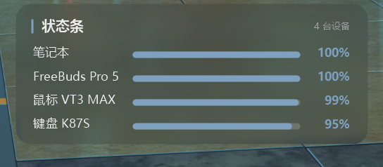

# Battery Statusbar · 桌面电量状态条

Windows 桌面悬浮电量条，毛玻璃圆角 + 低饱和配色，C# / WinForms（.NET 8）单进程实现，目标：**特别轻量**——框架依赖单文件约 180KB，空闲时 CPU 占用近乎为 0，内存经 `EmptyWorkingSet` 定期裁剪。



## 功能特性

### 显示
- **笔记本 / HID 键鼠 / 蓝牙耳机** 电量同屏显示，按电量从高到低排序
- 设备断开自动从列表消失、连上自动出现
- 窗口高度随设备行数自适应（顶边固定、底边伸缩）
- 名称列宽自适应（取最宽名称，进度条起止位置全部对齐）
- 电量 **<30%** 时该行进度条与百分比变**暗红色**提示（不刺眼）

### 背景
- 毛玻璃背景**实时取桌面壁纸**（`PrintWindow` 抓取 Progman 桌面 + box blur 外扩消除边缘伪影）
- 根据壁纸亮度自适应叠加暗色蒙版：亮壁纸加深蒙版、暗壁纸几乎不加，保证文字可读
- 32bpp 预乘 Alpha 分层窗口（`UpdateLayeredWindow`），逐像素透明、无边框亮线

### 交互
- 直接**拖动**移动位置，移动过程中实时居中吸附（无需移动完再吸）
- **右下角拖拽**缩放（0.7× ~ 1.8×），透明像素不挡鼠标
- **Win+D 显示桌面不会隐藏**（250ms 看门狗轮询恢复）
- 托盘图标菜单：
  - 显示 / 隐藏（双击托盘图标同效）
  - **刷新**（立即重扫所有设备，不用等刷新间隔）
  - 有窗口时自动隐藏
  - 开机自启（写入用户启动目录）
  - 退出

### 刷新策略（省电）
| 笔记本电量 | 刷新间隔 |
|---|---|
| ≥90% | 10 分钟 |
| 60% ~ 90% | 3 分钟 |
| <60% | 1 分钟 |

## 构建与运行

### 运行要求
- Windows 10 19041+ / Windows 11
- .NET 8 Desktop Runtime（框架依赖模式；如需完全离线可改 self-contained 发布）

### 构建
```powershell
dotnet publish -c Release -r win-x64 --self-contained false -p:PublishSingleFile=true
```

产物：`bin/Release/net8.0-windows10.0.19041.0/win-x64/publish/StatusBar.exe`

直接双击运行即可，无安装、无后台服务。开机自启请在托盘菜单勾选。

> 注意：TFM 必须是 `net8.0-windows10.0.19041.0`（带 Windows 版本号），否则 WinRT 投影不可用，`Windows.Devices.Enumeration` 等命名空间无法引用。

## 电量来源详解

状态条对每类设备选择"系统已知的最佳数据源"，逐层回退：

| 设备类型 | 数据源 | 说明 |
|---|---|---|
| 笔记本电池 | `GetSystemPowerStatus`（Win32） | 系统级，永远可用 |
| 迈从 K87S 键盘 | 厂商 HID Feature 协议（SetupAPI 枚举 + hid.dll） | 逆向官方软件通信协议实现 |
| 雷柏 VT3 MAX 鼠标 | 厂商 HID 报文协议（写 col05 / 读 col09） | 同上 |
| 华为 FreeBuds 系列 | **PnP 层 HFP 电池属性** | 见下文，与系统设置页同源 |
| 其他 BLE 外设 | GATT Battery Service（0x180F / 0x2A19） | 标准蓝牙电池服务 |

### 蓝牙耳机电量为什么"读不到"？

大多数资料让你读 `System.Devices.BatteryLife`——但该属性在 AEP / 接口层经常为空。实测华为耳机这类经典蓝牙音频设备的电量，实际挂在 **PnP 设备层**（`DeviceInformationKind.Device`）：

- 设备节点：`BTHENUM\{0000111e-...}`（HFP 免提服务接口）
- 属性键：`{104EA319-6EE2-4701-BD47-8DDBF425BBE5},2`（DEVPKEY_Bluetooth 命名空间，pid=2）
- 读取方式：`DeviceInformation.FindAllAsync("", props, DeviceInformationKind.Device)`，再按名称前缀与蓝牙列表合并

这正是 Windows "设置 → 蓝牙和其他设备" 页面显示的同一份数据。本项目即为该方案的完整实现。

### 已知边界
- **HFP 只上报一个汇总电量**——充电仓 / 左右耳分体电量需厂商私有协议（如华为电脑管家的私有通道），Windows 通用接口拿不到，本项目不做逆向
- 设备须向 Windows **标准协议**上报电量；仅厂商私有 APP 才能读电量的设备不会显示
- HID 键鼠走 2.4G 接收器时的电量协议因厂商而异，目前适配了迈从与雷柏的两款，其他型号需按各自协议扩展 `Program.cs` 中的 `ReadK87` / `ReadRapoo`

## 配置文件

随 exe 同目录自动生成，可手动编辑：

| 文件 | 作用 |
|---|---|
| `statusbar_cs.json` | 位置（`x`/`y`）与缩放（`scale`），拖动/缩放后自动保存 |
| `statusbar_cs_last.json` | 外设最后一次有效电量缓存，设备暂时离线时沿用旧值 |

`debug.log` 记录每轮扫描过程（蓝牙 AQS 结果、PnP 合并、刷新间隔决策），排查设备问题时可直接查看。

## 项目结构

```
StatusBarCs/
├── Program.cs          # 主程序：分层窗口渲染、HID 读取、交互、托盘、看门狗
├── Bt.cs               # 蓝牙电量：AEP/PnP/GATT 三层读取与合并
├── StatusBarCs.csproj  # net8.0-windows10.0.19041.0 / WinForms / x64
└── app.manifest        # PerMonitorV2 DPI 感知
```

## FAQ

**Q：为什么我的蓝牙耳机不显示？**
A：三步排查——① 确认耳机已连接（断开的设备不显示）；② 确认 Windows 设置页里能看到它的电量百分比（设置页也没有的，说明设备没走标准协议，本项目无法读取）；③ 点托盘"刷新"强制重扫。

**Q：能显示耳机充电仓电量吗？**
A：不能。Windows 标准接口（HFP/GATT）只提供汇总电量，充电仓/单耳电量是厂商私有协议（华为电脑管家走的是私有通道）。除非逆向厂商协议，否则无法实现。

**Q：常驻占用多少资源？**
A：框架依赖单文件约 180KB；空闲 CPU ≈ 0（刷新间隔最短 1 分钟，且每次刷新后裁剪工作集）；内存工作集经 `EmptyWorkingSet` 裁剪后维持在数 MB 量级。

**Q：和 Wallpaper Engine 之类的壁纸软件冲突吗？**
A：不冲突。背景取自系统壁纸渲染结果（Progman 桌面画面），换壁纸后 60 秒内自动跟随更新。

## License

仅供学习交流使用。
